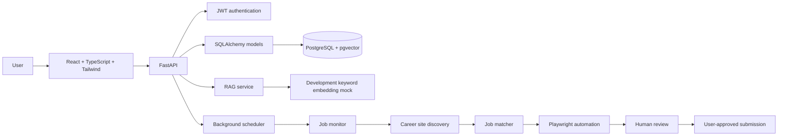

# AI Job Application Automation Platform

## Project overview

ApplyMate is a prototype job-application assistant for students and job seekers. It currently supports resume upload/parsing, career-page checks, calendar-based schedules, basic browser form automation, and optional email alerts for schedules that need attention.

The intended design separates deterministic software from model-based reasoning:

1. Browser DOM extraction and field classification are deterministic.
2. Resume retrieval is user-scoped. The current embedding implementation is a development-only keyword mock, not semantic retrieval.
3. A concrete LLM integration for application answers is planned but not implemented.
4. Human approval is required before submission by default.
5. No provider-specific logic is allowed to leak across the application.

## Architecture



## Phase plan

- Phase 1: Project setup, backend, frontend, PostgreSQL, authentication, and a dashboard shell.
- Phase 2: Resume upload, parsing, metadata extraction, and ownership-safe management.
- Phase 3: RAG, chunking, embeddings, pgvector, and semantic retrieval.
- Phase 4: Company and job tracking, calendar, and scheduler.
- Phase 5: Career page discovery, scraping, and ATS detection.
- Phase 6: Playwright browser automation.
- Phase 7: AI form understanding.
- Phase 8: RAG-powered form filling.
- Phase 9: Human review and application approval.
- Phase 10: Application tracking and history.
- Phase 11: Test coverage and quality gates.
- Phase 12: Dockerization and deployment.

## Features

- Multi-resume upload and management
- PDF and DOCX parsing
- Structured profile extraction
- User-scoped resume vector search (development-only keyword embeddings)
- LLM provider interface (concrete provider integrations are not implemented yet)
- Company and job tracking
- Calendar and dashboard
- Human review before submission
- Browser automation with Playwright
- Scheduled careers-page checks
- SMTP email alerts when a scheduled application needs manual attention
- Secure JWT authentication and ownership validation
- PostgreSQL plus pgvector

## Tech stack

- Python 3.14+
- FastAPI
- SQLAlchemy
- PostgreSQL + pgvector
- Redis
- React
- TypeScript
- Vite
- Tailwind CSS
- Playwright
- PyMuPDF
- python-docx
- OpenAI / Gemini / Anthropic API-key configuration placeholders (not wired to providers yet)
- Docker Compose

## Project structure

```text
project/
├── backend/
│   ├── app/
│   │   ├── api/
│   │   │   └── routes/
│   │   ├── core/
│   │   ├── database/
│   │   ├── models/
│   │   ├── schemas/
│   │   ├── services/
│   │   └── main.py
│   ├── tests/
│   ├── Dockerfile
│   ├── requirements.txt
│   └── storage/
├── frontend/
│   ├── src/
│   ├── Dockerfile
│   ├── index.html
│   ├── package.json
│   ├── postcss.config.js
│   ├── tailwind.config.js
│   └── vite.config.ts
├── .env.example
├── docker-compose.yml
├── README.md
└── .gitignore
```

## Configuration

For local backend development, the settings loader reads `.env` from the current
working directory: run from `backend/` and put backend values in `backend/.env`.
For Docker Compose, Compose reads interpolation values from the repository-root
`.env`, so copy the root `.env.example` there as well. Keep both files out of
version control, and never put API keys in the frontend. The backend Docker build
excludes local `.env` files and uploaded resume data.

### Backend values

- `SECRET_KEY`: JWT signing secret.
- `APP_ENV`: runtime environment (`development`, `test`, or `production`).
- `DATABASE_URL`: PostgreSQL connection URL.
- `REDIS_URL`: Redis connection URL.
- `OPENAI_API_KEY`, `GEMINI_API_KEY`, `ANTHROPIC_API_KEY`: provider credentials.
- `LLM_PROVIDER`: active provider name.
- `LLM_MODEL`: model used by the active provider.
- `EMBEDDING_MODEL`: embedding model.
- `BROWSER_HEADLESS`: run browser automation without a visible window.
- `MAX_RETRIES`, `JOB_CHECK_INTERVAL_SECONDS`: monitoring behavior.
- `SMTP_HOST`, `SMTP_PORT`, `SMTP_USERNAME`, `SMTP_PASSWORD`, `SMTP_FROM_ADDRESS`,
  `SMTP_STARTTLS`: optional SMTP configuration for email alerts when an application
  needs manual attention. The recipient is the authenticated user's account email.

When concrete LLM integrations are added, only the selected provider's API key should be needed.

**Current RAG limitation:** resume embeddings use an 8-dimensional keyword mock, and
there is no concrete LLM provider wired into application answering yet. The LLM API
key/model entries above are configuration placeholders; adding a key alone will not
enable LLM calls. Keep provider keys in the backend `.env` only, never in `frontend`.

Career-page discovery first fetches static HTML, then falls back to a visible-page
render with Playwright and checks up to three linked search/results pages. It uses
simple link/title heuristics and is not guaranteed to work with every site. Many ATS
sites render content dynamically, need search input/location selection, or require sign-in, and form
automation is best-effort; unsupported forms, CAPTCHA, private questions, and
unanswered required fields must be completed by the user. There is no guarantee that
every job portal can be automated.

### Frontend values

- `VITE_API_BASE_URL`: backend API base URL, such as `http://localhost:8000/api`.

## Setup

### Prerequisites

- Docker Desktop or Docker Engine
- Python 3.15+
- Node.js 22+
- PostgreSQL 16+

### Run locally with Docker Compose

The root Compose file is for local development and includes live source mounts,
the Vite development server, and development-only database credentials.

```bash
docker compose up --build
```

The frontend is available at `http://localhost:5173` and the backend API at
`http://localhost:8000`. API documentation is available at
`http://localhost:8000/docs`.

### Single-host Docker deployment

The production Compose configuration builds a static frontend served by Nginx,
proxies API requests internally, keeps PostgreSQL and the backend off public
ports, runs the API as a non-root user, and persists the database and uploaded
resumes in named volumes.

1. On a Linux host with Docker Compose installed, copy `.env.production.example`
   to `.env.production`.
2. Set `APP_HOSTNAME` to the public hostname, choose a strong random
   `POSTGRES_PASSWORD` containing only letters/numbers, and generate `SECRET_KEY`
   using the command shown in the example file.
3. Configure DNS and HTTPS termination using a trusted reverse proxy/load
   balancer. Forward the hostname to port `APP_PORT` (8080 by default).
4. Start the single backend instance:

   ```bash
   docker compose --env-file .env.production -f docker-compose.prod.yml up --build -d
   ```

5. Check `https://your-hostname/health` and review container logs with
   `docker compose --env-file .env.production -f docker-compose.prod.yml logs -f`.
6. Set `CORS_ORIGINS` and `ALLOWED_HOSTS` if your deployment uses a different
   origin or if a reverse proxy forwards a different host header. In production
   the API accepts only HTTPS CORS origins and the configured hostnames.

Do not scale the backend to multiple instances: the current in-process scheduler
would run once per instance. Back up both `postgres_data` and `resume_storage`
volumes and test restoring them. This is a single-host deployment baseline, not
a managed high-availability setup. Database schema setup currently uses
SQLAlchemy `create_all` plus a small compatibility alteration at startup; add
versioned migrations before evolving a production database schema.

### Run backend locally

```bash
cd backend
python -m venv .venv
source .venv/bin/activate
pip install -r requirements.txt
uvicorn app.main:app --reload
```

On Windows PowerShell:

```powershell
cd backend
py -3.14 -m venv .venv
.\.venv\Scripts\Activate.ps1
python -m pip install -r requirements.txt
python -m playwright install chromium
python -m uvicorn app.main:app --reload
```

### Run frontend locally

```bash
cd frontend
npm install
npm run dev
```

The scheduler currently runs in the FastAPI application's lifespan. The two
legacy worker Compose services are disabled behind the `legacy` profile; separate
worker processes are not implemented yet, so do not enable that profile.

### Run tests

```bash
cd backend
python -m pytest
```

## Usage

1. Register or log in.
2. Upload one or more resumes.
3. Select a default resume.
4. Open the calendar and schedule a job monitor.
5. Install a company career discovery result.
6. Review matched jobs and generated answers.
7. Approve or edit before submission.
8. Use automation only for the user's own applications and only when the configured workflow permits it.
9. Configure SMTP values in `.env` if you want email alerts when a CAPTCHA,
   unanswered required question, unsupported form, or other issue needs your help.

## Security considerations

- Require JWT authentication for every user-specific endpoint.
- Validate ownership before returning or mutating records.
- Never accept arbitrary credentials as a substitute for authenticated sessions.
- Never expose API keys in frontend bundles.
- Disable automatic submission by default.
- Respect robots.txt, site terms, and rate limits.
- Stop automation when CAPTCHA or login requirements are encountered.
- Send the account owner an email when an automated scheduled application needs attention (when SMTP is configured).
- Do not bypass anti-bot protections or authentication.
- Do not submit applications without user review unless the explicit trusted mode is enabled.

Production mode validates the secret key, allowed hostnames, and CORS origins;
disables interactive API documentation; and exposes a database-aware readiness
check at `/health/ready`. Configure only the actual deployment hostname in
`ALLOWED_HOSTS` and the HTTPS website origin in `CORS_ORIGINS`.

## Limitations

- Automated form completion depends on the website's DOM, accessibility attributes, and legal requirements.
- Some job portals require multiple authentication and consent steps.
- LLM-generated answers should be validated and may require user correction.
- Career discovery is best-effort and may require manual review when a site is unusual.
- The container environment is suitable for development and local testing, not full production scaling without security hardening.

## Future improvements

- Production-grade Redis task queue
- Worker observability and dead-letter handling
- More ATS-specific adapters
- More robust resume extraction models
- Human-in-the-loop review UI
- Encrypted object storage
- Rate-limit and anti-bot policy enforcement
- Audit logs and exportable activity history
- Multi-tenant organization support
- Automated credentials and identity verification

## Important design decisions

- The application uses SQLAlchemy and a provider-neutral API layer.
- pgvector is used for resume chunk similarity search.
- All resume and application queries enforce user ownership.
- LLMs are used for reasoning and structured answer creation, not for directly controlling the entire application.
- Submission is disabled by default and requires approval.
- Browser automation stops when CAPTCHA, authentication, or unsupported flow states are detected.
